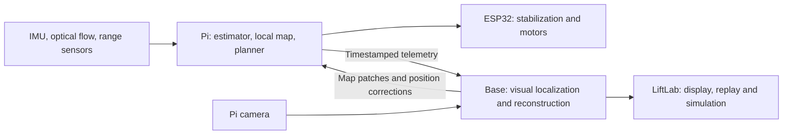

# Pi Zero navigation and mapping roadmap

**13 October 2026 · Proposed roadmap · Hardware performance and flight behavior unverified**

Build a drone that maintains a small, useful model of its surroundings and navigates through it. Target the **original Raspberry Pi Zero 1.3**, with an ESP32 handling stabilization and motor control. Start with slow movement in a limited indoor area. Extend to larger spaces only after measuring localization, sensing coverage and stopping performance.

The preferred architecture is **local navigation that works independently, enhanced by an optional base station**. Detailed visual reconstruction can run at the base; the Pi needs nearby geometry, its estimated position and uncertainty. Background: [autonomous navigation review](autonomous-navigation-review-2026-10-13.md).

## 1. Two operating modes, one onboard core

| Mode | Pi responsibilities | Base responsibilities | Intended capability |
| --- | --- | --- | --- |
| **Onboard only** | Fuse sensors, estimate motion, update a small obstacle map, select feasible movement and command the ESP32 | Optional monitoring and recording | Local avoidance and short routes within measured sensing/localization limits |
| **Base assisted** | Continue the same local loop; incorporate timestamped map and position corrections | Process images and telemetry, improve localization, reconstruct larger areas, propose routes | Better map consistency and longer navigation, while immediate avoidance remains onboard |

Use small native modules for the onboard loop. Bound camera work, memory and queues so that expensive perception cannot delay navigation. The original Zero's 1 GHz single core and 512 MB RAM favor compact geometry and selective vision. Verify ARMv6 library compatibility and actual camera/encoder support. Dense camera-only reconstruction onboard is outside the initial scope.

## 2. Represent only what flight needs

Maintain a rolling local map with **free, occupied and unknown space**, plus confidence and observation age. Old observations lose authority; a missing or invalid range return does not automatically establish free space.

An illustrative 10 × 10 × 4 m volume at 20 cm resolution contains 50,000 cells: about **200 KB at four bytes per cell**, before planner and indexing overhead. These are design examples, not measured requirements. Start with a horizontal occupancy map and floor/ceiling clearance for nearly constant-altitude motion; add full 3D cells when routes need movement over or under obstacles.

Inflate obstacles by aircraft size, localization error and a clearance margin. Limit speed to the distance within which the drone can sense, react and stop:

`required clear distance = speed × total delay + speed² / (2 × braking acceleration) + margin`

Choose map resolution and permitted gaps from measured uncertainty. Preserve finer geometry near the intended path and coarser geometry farther away. A visually convincing reconstruction does not establish collision-free space, especially where surfaces were never observed.

Start with ray-based occupancy updates: accumulate bounded probabilistic evidence along valid observations, respecting each sensor's beam/cone and uncertainty. Use a small fixed grid first; an octree or distance field is an optional later optimization. The OctoMap and voxblox references below explain these representations.

## 3. Sensor strategy and localization

**Localization is the main technical risk.** Correct distances create an incorrect map if the drone's estimated position or orientation is wrong. IMU integration alone cannot sustain accurate position; optical flow reduces short-term drift but still needs occasional position references for longer routes.

| Sensor | Planned role | Constraint or decision |
| --- | --- | --- |
| IMU: gyro and accelerometer | Attitude, short-term prediction and rotation compensation | Verify calibration, axes and timestamps; keep stabilization on ESP32 |
| Downward flow + downward ToF | Ground-relative velocity and height | Preferred local motion reference; requires suitable texture, light and operating height |
| Forward/side ToF | Immediate proximity and obstacle-map updates | Match coverage to allowed motion; isolated beams leave blind areas |
| Multizone ToF | Coarse depth image with little host processing | Evaluate as an upgrade; an 8 × 8 sensor supplies useful but sparse geometry |
| Ultrasonic | Optional height/proximity cross-check | Measure propeller interference, cone width and interaction between sensors |
| Regular or fisheye Pi camera | Selected feature tracking, landmarks and base reconstruction | Fisheye trades angular detail for coverage; calibrate lens, mounting and exposure |
| Barometer, compass, GNSS or indoor anchors | Complementary height, heading or position references | Select by environment; heading alone does not fix position drift |

Current inventory includes an MPU6050-based module, barometer, unresolved compass variant, GPS, TOF250 and two reported-working Pi cameras. TOF250 and physical optical-flow integration need drivers. Do not assume both cameras can capture simultaneously on the Zero's single CSI interface. A separate downward flow chip would leave the Pi camera available for forward/wide views. See [inventory](TODO.md) and [physical support boundaries](boards.md).

For longer indoor routes, evaluate visual landmarks, fiducial markers, UWB or base-derived pose corrections. Outside, reassess lighting, range, wind and GNSS accuracy rather than carrying indoor assumptions forward.

The first estimator candidate is a compact **extended Kalman filter (EKF)** combining IMU prediction with flow, range and available position references. Compare it with LiftLab's existing estimator before replacing anything. Use known-size, surveyed AprilTags as an optional repeatable indoor reference. Full visual-inertial odometry (VIO) is a separate base-side experiment.

## 4. Selective perception: the foveated approach

- Retain coarse image coverage while spending more computation on the planned swept volume, uncertain openings and nearby obstacles.
- Track a bounded set of features distributed across the view; peripheral features can be essential for estimating motion.
- Select keyframes by viewpoint change, new geometry or increasing uncertainty, rather than processing every frame equally.
- Drop stale frames instead of accumulating latency. Reduce image size or feature count when the processing budget is exceeded.
- Let the planner slow down or turn to inspect unknown space before entering it.

Benchmark a regular camera and fisheye using the same recorded movements. Evaluate navigation usefulness, timing and localization error alongside image quality.

For a first software vision experiment, use **Shi–Tomasi feature selection and pyramidal Lucas–Kanade tracking**, with spatial quotas and tracking-quality rejection. RAPTOR supplies relevant active-viewpoint planning ideas, but our coarse-image/fine-region processing policy remains an engineering proposal, not a published Zero implementation.

## 5. Base-station contract

Send compressed images/keyframes and timestamped sensor data. Return compact nearby map patches, useful landmarks, uncertainty and position corrections; keep detailed meshes or splats at the base for visualization.

Define capture times, clock alignment, units, coordinate frames and sensor calibration identifiers from the start. Each patch needs a map version, spatial extent and observation time. Reject outdated or incompatible updates and apply accepted updates consistently.

Keep the local motion frame continuous. A base correction, including one caused by recognizing a previously visited place, must update its relationship to the global map without abruptly moving control targets. Delayed pose measurements must be reconciled with motion since capture.

Use the continuous `odom` versus globally corrected `map` distinction described in [REP-105](https://github.com/ros-infrastructure/rep/blob/master/rep-0105.rst). This is a coordinate-frame convention we can adopt without requiring ROS on the Pi.

Fresh local obstacle observations take priority over an older base map. Bound operation during link loss by local sensing and localization quality. Hover requires a usable position estimate; define a controlled fallback when that estimate is lost. The original Zero needs an external network interface, whose power, bandwidth and delay must be measured with camera capture active.

## 6. LiftLab integration

| Existing foundation | Roadmap addition |
| --- | --- |
| [Portable navigation core](../runner/fc/nav_core.h) used by Pi and WebAssembly simulation | Obstacle-map planner and explicit visual-pose/uncertainty inputs; physical flow/range drivers |
| [Model and map imports](maps.md), with collision boxes/meshes | Converter from reconstructed geometry to simplified LiftLab collision geometry, with verified scale and axes |
| Saved maps; switching maps resets flight | Separate live map-patch interface and estimated-world overlay that preserve the running flight |
| [Simulated sensors](../js/sensors.js), including analytical flow and terrain range raycasting | General ToF/sonar coverage models, multizone readings and camera observations for perception testing |

Use LiftLab for **visualization, recorded-data replay and closed-loop simulation**. Show estimated position, uncertainty, observation age and sensor coverage. Keep simulated ground truth separate from the map available to navigation; evaluate collisions against the former. Inject noise, drift, delayed corrections and link interruptions.

Run expensive reconstruction in a base service and use LiftLab as the analysis interface. Shared navigation code improves reproducibility, but simulator results do not establish real flight readiness.

## 7. Milestones and exit checks

Progress is evidence-based; dates and throughput targets follow the first hardware benchmark.

| Stage | Deliverable | Exit check |
| --- | --- | --- |
| **0 — Define the operating envelope** | Sensor selection, calibration/coordinate conventions, log format and Pi benchmark | Document intended speed, minimum clearance, localization-error allowance and processing deadlines; verify actual capture, communication, power and payload constraints |
| **1 — Handheld capture and motion estimation** | Motors-off sensor/image logger and replayable local position estimate | Measured distances and rotations agree with references within the chosen budget; quantify drift, dropouts, CPU/RAM and timing under simultaneous capture/transmission |
| **2 — Onboard local map** | Rolling occupancy map and simple local planner, displayed in LiftLab | Repeated passes align obstacles within the clearance budget; unknown space remains unknown; planner rejects blocked or insufficiently observed routes |
| **3 — Simulation and replay** | Shared planner with simulated sensing and recorded-data playback | Complete a defined obstacle course against independent ground truth; demonstrate bounded behavior under stale sensors, uncertainty growth and computation overload |
| **4 — Base assistance** | Image-processing service, map/pose protocol and live LiftLab updates | Compare against onboard-only recordings; demonstrate improved drift/map consistency, correct delayed updates and bounded behavior during outages or map-frame corrections |
| **5 — Controlled flight validation** | Slow, short routes using the validated local loop; then base-assisted trials | First establish airframe/stabilization readiness separately. Measure actual stopping, tracking and fallback behavior; expand speed, distance and autonomy only within demonstrated limits |

Stages 3 and 4 can proceed in parallel once the recording and map interfaces are stable. Onboard-only flight trials do not require stage 4; all flight trials require the relevant bench and simulation gates.

**First deliverable:** a handheld Pi/ESP32 sensing rig that produces a replayable local obstacle map in LiftLab. This tests the central idea before adding flight dynamics. Defer dense onboard reconstruction, object recognition and large-area autonomy until this foundation works.

## 8. Relevant methods, papers and repositories

**Sources checked 13 October 2026.** This is an implementation shortlist, not a ranking of every current research system. “Onboard candidate” means worth adapting and benchmarking; none of these repositories has been validated on our Zero. Stage numbers refer to the milestones above.

### Calibration, local estimation and the first map

| Method and paper | Repository / implementation | How we would use it |
| --- | --- | --- |
| **Camera/IMU calibration — Furgale et al. (IROS 2013):** [Unified Temporal and Spatial Calibration for Multi-Sensor Systems](https://furgalep.github.io/bib/furgale_iros13.pdf) | [Kalibr](https://github.com/ethz-asl/kalibr) | **Stages 0–1, base/offline.** Estimate lens parameters, sensor mounting transforms and timing offsets. Includes camera-model choices relevant to fisheye; calibration quality is a prerequisite for fusion. |
| **Sparse feature tracking — [Lucas–Kanade (1981)](https://publications.ri.cmu.edu/an-iterative-image-registration-technique-with-an-application-to-stereo-vision-ijcai) and [Shi–Tomasi, Good Features to Track (1994)](https://publications.ri.cmu.edu/good-features-to-track)** | [OpenCV](https://github.com/opencv/opencv), [optical-flow implementation guide](https://docs.opencv.org/4.x/d4/dee/tutorial_optical_flow.html) | **Stages 1–2, onboard experiment.** Track a bounded number of image features. Provides image motion, not a complete metric pose or obstacle map; benchmark a reduced native build. |
| **Flow/range EKF — Greiff (2017):** [Optical Flow Driven State Estimation, master's thesis](https://www.lunduniversity.lu.se/publication/8905295) | [Crazyflie firmware](https://github.com/bitcraze/crazyflie-firmware), [flow measurement model](https://github.com/bitcraze/crazyflie-firmware/blob/master/src/modules/src/kalman_core/mm_flow.c) | **Stages 1–2, onboard method reference.** Concrete example of fusing inertial, flow and ranging observations on a small aircraft. Adapt models to our sensors and mounting; firmware is not a ready Pi/ESP32 port. |
| **Fiducial pose estimation — Wang and Olson (IROS 2016):** [AprilTag 2: Efficient and robust fiducial detection](https://april.eecs.umich.edu/papers/details.php?name=wang2016iros) | [AprilTag, current implementation](https://github.com/AprilRobotics/apriltag) | **Stages 1–3, Pi candidate or base.** Known-size tags in known positions provide repeatable pose references. Detection rate, image decimation and pose ambiguity need testing. |
| **Probabilistic occupancy — Hornung et al. (2013):** [OctoMap](https://www.arminhornung.de/Research/pub/hornung13auro.pdf) | [OctoMap](https://github.com/OctoMap/octomap) | **Stages 2–3.** Adopt occupied/free/unknown semantics and probabilistic sensor updates in our small onboard grid. Evaluate the full octree library at the base if larger maps justify it. |

### Base-station localization and reconstruction

| Method and paper | Repository | How we would use it |
| --- | --- | --- |
| **Filter-based VIO — Geneva et al. (ICRA 2020):** [OpenVINS](https://pgeneva.com/downloads/papers/Geneva2020ICRA.pdf) | [OpenVINS](https://github.com/rpng/open_vins) | **Stage 4, base baseline.** Estimate motion from timestamped camera/IMU data; compare with local flow/range estimation. VIO supplies pose and sparse features, not a complete dense obstacle map. |
| **Visual-inertial SLAM — Campos et al. (T-RO 2021):** [ORB-SLAM3](https://arxiv.org/abs/2007.11898) | [ORB-SLAM3](https://github.com/UZ-SLAMLab/ORB_SLAM3) | **Stage 4, alternative base baseline.** Adds map reuse/relocalization and supports pinhole/fisheye models. Evaluate initialization and map-correction behavior on our recordings; do not run both SLAM systems by default. |
| **Structure from Motion / Multi-View Stereo — Schönberger and Frahm (CVPR 2016):** [Structure-from-Motion Revisited](https://demuc.de/papers/schoenberger2016sfm.pdf) | [COLMAP](https://github.com/colmap/colmap), optional [OpenMVS](https://github.com/cdcseacave/openMVS) | **Stages 2–4, offline/base.** Reconstruct a photographed test space for comparison and LiftLab import. COLMAP includes dense reconstruction; OpenMVS adds an optional mesh/texturing workflow. Establish metric scale using measured references. |
| **Surface and distance-field fusion — Oleynikova et al. (IROS 2017):** [voxblox](https://arxiv.org/abs/1611.03631) | [voxblox](https://github.com/ethz-asl/voxblox) | **Stage 4, optional base mapper.** Fuse posed depth into a truncated signed distance field (TSDF), then derive an obstacle-distance field (ESDF) for planning. Requires depth and poses; it does not infer them from RGB alone. |
| **Learned few-view reconstruction — [MapAnything (2025 preprint; 3DV 2026)](https://arxiv.org/abs/2509.13414)** | [MapAnything](https://github.com/facebookresearch/map-anything) | **After the stage 4 baseline, GPU base experiment.** Predict geometry/cameras from selected keyframes, optionally using known intrinsics, poses or depth. Check scale and surfaces against range measurements; predictions do not establish unobserved free space. |
| **Incremental learned SLAM — [MASt3R-SLAM (CVPR 2025)](https://arxiv.org/abs/2412.12392)** | [MASt3R-SLAM](https://github.com/rmurai0610/MASt3R-SLAM) | **Later GPU-base comparison.** Tracking, local fusion and loop closure are relevant to continuous updates. Treat as a research alternative with substantial compute needs, not a Zero deployment candidate. |

### Planning, active perception and evaluation

The initial onboard planner should evaluate a small, bounded set of short motions, including stopping, against inflated obstacles and sensing coverage. The following references guide later extensions and base/LiftLab comparisons.

| Method and paper | Repository / implementation | How we would use it |
| --- | --- | --- |
| **Search over feasible motion primitives — Liu et al. (IROS 2017):** [Search-based Motion Planning for Quadrotors using Linear Quadratic Minimum Time Control](https://arxiv.org/abs/1709.05401) | [Motion Primitive Library](https://github.com/sikang/motion_primitive_library) | **Stages 2–3, base/LiftLab baseline.** Search motions that account for velocity and dynamics. Benchmark a bounded subset onboard; a geometrically clear waypoint sequence alone does not prove flyability. |
| **Local trajectory optimization — Zhou et al. (RA-L 2021):** [EGO-Planner](https://arxiv.org/abs/2008.08835) | [EGO-Planner](https://github.com/ZJU-FAST-Lab/ego-planner), [EGO-Swarm](https://github.com/ZJU-FAST-Lab/ego-planner-swarm) | **Stages 3–4, later comparison.** Optimizes trajectories without constructing an ESDF. Original maintainers recommend EGO-Swarm even for one drone. Published planning timings are not full-pipeline Zero benchmarks. |
| **Active perception — Zhou et al. (2020 preprint):** [RAPTOR](https://arxiv.org/abs/2007.03465) | [Related Fast-Planner code](https://github.com/HKUST-Aerial-Robotics/Fast-Planner) | **Later stage 3–4 experiments.** Choose motion/yaw to observe relevant unknown space earlier. This concerns viewpoints, not specifically foveated pixel processing. The repository still marks its `active_perception` module as forthcoming; do not assume a complete RAPTOR implementation. |

Two practical supporting references:

- [PX4 collision prevention](https://docs.px4.io/main/en/computer_vision/collision_prevention) describes angular obstacle sectors, observation age, coverage and braking constraints. Borrow these ideas for a compact local supervisor; the documented companion setup is untested and its original project archived.
- [evo](https://github.com/MichaelGrupp/evo) evaluates odometry/SLAM trajectories at the base. Use absolute and relative pose error alongside missed obstacles, false obstacles, latency and memory. Record alignment settings explicitly so scale correction cannot hide metric-scale errors needed for flight.

**Suggested starting selection:** Kalibr for calibration; flow/range EKF concepts plus optional AprilTag references; a fixed occupancy grid; bounded motion primitives; LiftLab replay. Then compare OpenVINS or ORB-SLAM3 at the base and use COLMAP for offline geometry. Add learned reconstruction only after this measured baseline.

**Reuse terms:** select versions and inspect code and model licenses before incorporating dependencies. In particular, [MapAnything checkpoints](https://github.com/facebookresearch/map-anything#models) differ: `facebook/map-anything-apache` is Apache-2.0, while `facebook/map-anything` is CC-BY-NC-4.0. MASt3R-SLAM code is CC-BY-NC-SA-4.0; pretrained dependencies have separate terms. These research options are not unconditional product dependencies.

## 9. Hardware references

- [Raspberry Pi Zero specifications](https://www.raspberrypi.com/products/raspberry-pi-zero/): target hardware.
- [Bitcraze Flow deck](https://www.bitcraze.io/products/flow-deck-v2/) and [Multi-ranger](https://www.bitcraze.io/products/multi-ranger-deck/): examples of lightweight motion and proximity sensing.
- [ST VL53L5CX](https://www.st.com/en/imaging-and-photonics-solutions/vl53l5cx.html): example multizone ToF sensor; component suitability remains to be tested.

External references support the architecture and component examples. They do not validate this implementation or the current airframe.
